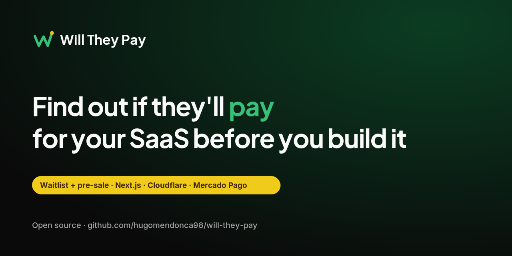

**[Read in Brazilian Portuguese (README.pt-BR.md)](README.pt-BR.md)** · [](LICENSE)

**Find out if people will pay for your SaaS before you build it.**

Will They Pay is an open source waitlist and pre-sale template. Launch a page for your idea, collect sign-ups, and take paid reservations via Pix, card, or boleto with Mercado Pago. Built with Next.js 16 on Cloudflare Workers and D1.

This repository is public. **Never commit real tokens, secrets, account IDs, or D1 database IDs.**

## What you get

- Marketing landing page (copy in `src/content/site.ts`) with waitlist lead form and **demo** checkout plans to try Checkout Pro.
- Lead capture (name, email, phone, message) with Zod validation, server actions, and D1 persistence.
- Checkout Pro flow: creates an order in D1, creates a Mercado Pago preference, redirects to checkout, and handles `success` / `failure` / `pending` return pages.
- `POST /api/webhooks/mercadopago` with `x-signature` validation (HMAC-SHA256) and order/payment updates in D1.
- Typed payment layer, Vitest + MSW (no real Mercado Pago calls in tests).
- GitHub Actions CI: lint, typecheck, and tests.

UI copy is **Brazilian Portuguese**. Code, identifiers, and comments are **English**.

## Stack and requirements

| Piece | Version / notes |
| --- | --- |
| **Runtime** | Node.js **22+** (`engines` in `package.json`) |
| **Package manager** | **pnpm** (`packageManager` in `package.json`; enable with `corepack enable`) |
| **Framework** | Next.js **16.3.8** (App Router) |
| **Deploy target** | Cloudflare Workers via [`@opennextjs/cloudflare`](https://github.com/opennextjs/cloudflare) |
| **Database** | Cloudflare **D1** + **Drizzle ORM** |
| **Payments** | Mercado Pago **Checkout Pro** (Pix, card, boleto) |
| **Styling** | Tailwind CSS 4 + shadcn/ui |

**Accounts you need:**

1. [Cloudflare](https://dash.cloudflare.com/) account with Workers enabled.
2. [Mercado Pago Developers](https://www.mercadopago.com.br/developers/panel/app) application (test credentials for local/sandbox).
3. **Wrangler CLI** (included as a dev dependency). Log in before remote D1 or deploy:

   ```bash
   pnpm wrangler login
   ```

## Scripts

| Command | What it does |
| --- | --- |
| `pnpm run dev` | `next dev` — local Next.js with Cloudflare bindings via OpenNext dev integration |
| `pnpm run build` | `next build` |
| `pnpm run preview` | `opennextjs-cloudflare build` + `opennextjs-cloudflare preview` (Workers runtime locally) |
| `pnpm run deploy` | `opennextjs-cloudflare build` + `opennextjs-cloudflare deploy` |
| `pnpm run test` | Vitest (single run) |
| `pnpm run test:watch` | Vitest watch mode |
| `pnpm run typecheck` | `tsc --noEmit` |
| `pnpm run lint` | ESLint |
| `pnpm run format` | Prettier write |
| `pnpm run format:check` | Prettier check |
| `pnpm run db:generate` | `drizzle-kit generate` → SQL in `./drizzle` |
| `pnpm run db:migrate` | Apply migrations to **local** D1 (alias of `db:migrate:local`) |
| `pnpm run db:migrate:local` | `wrangler d1 migrations apply DB --local` |
| `pnpm run db:migrate:remote` | `wrangler d1 migrations apply DB --remote` |
| `pnpm run cf-typegen` | Regenerate `cloudflare-env.d.ts` from Wrangler bindings |

Use `pnpm run <script>` for package scripts. pnpm ships a built-in `deploy` command (workspace deploy), so plain `pnpm deploy` does **not** run the `deploy` script in `package.json` and may fail with `ERR_PNPM_NOTHING_TO_DEPLOY`.

## Run locally (step by step)

### 1. Clone and install

```bash
git clone https://github.com/hugomendonca98/will-they-pay.git
cd will-they-pay
corepack enable
pnpm install
```

### 2. Local environment file

```bash
cp .dev.vars.example .dev.vars
```

Edit `.dev.vars` with your **Mercado Pago test** credentials (see [Configure](#configure-the-project)). `.dev.vars` is gitignored.

Optional: copy `.env.example` to `.env.local` if you need Next-specific tooling; **secrets and Worker vars belong in `.dev.vars`**, not in git.

### 3. Apply D1 migrations (local)

```bash
pnpm run db:migrate
```

This uses the placeholder `database_id` in `wrangler.jsonc` — that is expected for **local** D1. Tables are created in Wrangler’s local D1 store.

### 4. Start the dev server

```bash
pnpm run dev
```

Open [http://localhost:3000](http://localhost:3000). In development, `next.config.ts` calls `initOpenNextCloudflareForDev()` so D1 and vars from `.dev.vars` are available to server code.

### 5. Preview on the Workers runtime (optional)

```bash
pnpm run preview
```

This builds the OpenNext output and runs Wrangler’s dev server. Check the terminal for the URL (commonly `http://localhost:8787`). If tables are missing, run `pnpm run db:migrate:local` again against that local D1.

Set `APP_URL` in `.dev.vars` to match the URL you use for checkout return links (no trailing slash).

### 6. Quality checks

```bash
pnpm run lint
pnpm run typecheck
pnpm run test
```

CI runs the same three commands; tests use in-memory SQLite and MSW — they do **not** read `.dev.vars` or call Mercado Pago.

## Configure the project

### Environment variables and secrets

| Name | Kind | Local | Production |
| --- | --- | --- | --- |
| `NEXTJS_ENV` | var | `.dev.vars` — use `development` for `pnpm run dev` | Not required for deploy |
| `APP_URL` | public var | `.dev.vars` — e.g. `http://localhost:3000` | `vars` in `wrangler.jsonc` (HTTPS URL, no trailing slash) |
| `MERCADOPAGO_SANDBOX` | public var | `.dev.vars` — `true` for sandbox | `vars` in `wrangler.jsonc` — `true` or `false` |
| `DEMO_MODE` | public var (optional) | `.dev.vars` — omit or `false` (default off) | `vars` in `wrangler.jsonc` or Cloudflare dashboard — set `"true"` only on a public demo deploy |
| `MERCADOPAGO_ACCESS_TOKEN` | **secret** | `.dev.vars` | `pnpm wrangler secret put MERCADOPAGO_ACCESS_TOKEN` |
| `MERCADOPAGO_WEBHOOK_SECRET` | **secret** | `.dev.vars` | `pnpm wrangler secret put MERCADOPAGO_WEBHOOK_SECRET` |

**Where to get Mercado Pago values**

1. Open [Your integrations](https://www.mercadopago.com.br/developers/panel/app) and create or select an application.
2. **Credentials** → copy the **test** Access Token (`TEST-…`) into `MERCADOPAGO_ACCESS_TOKEN` for local/sandbox. Use the **production** token only as a Worker secret when you go live.
3. **Webhooks** → configure notifications (see below) → reveal the **secret** and set `MERCADOPAGO_WEBHOOK_SECRET`.

The app treats placeholder values (e.g. `replace-with-your-test-access-token`) as missing so checkout fails closed (`src/lib/env.ts`).

`APP_URL` drives Checkout Pro `back_urls` and the `notification_url` sent when creating a preference (`{APP_URL}/api/webhooks/mercadopago`). `auto_return` is only sent when `APP_URL` starts with `https://` (`src/lib/payments/service.ts`).

### Public demo banner (optional)

`DEMO_MODE` is evaluated **at runtime** from the Worker environment (`getCloudflareContext`), not at build time — the same deploy artifact can be toggled without rebuilding.

- **Default:** off (omit `DEMO_MODE` or set it to `false`). The template `wrangler.jsonc` does not enable it, so clones do not inherit the banner.
- **Local / preview:** add `DEMO_MODE=true` to `.dev.vars` (commented in `.dev.vars.example`).
- **Cloudflare:** set `DEMO_MODE` to `"true"` under `vars` in `wrangler.jsonc` for a demo/staging Worker only, or add the variable in the [Cloudflare dashboard](https://dash.cloudflare.com/) → **Workers & Pages** → your worker → **Settings** → **Variables**. Banner copy is in `site.demoBanner` (`src/content/site.ts`).

### D1 database

`wrangler.jsonc` ships with a **placeholder** `database_id` (`00000000-0000-0000-0000-000000000000`). Local D1 works with that placeholder. For **production**:

```bash
pnpm wrangler d1 create will-they-pay
```

Copy the printed `database_id` into `wrangler.jsonc` under `d1_databases` (do not commit real IDs if this repo is a shared template — each deployment can use its own database).

After schema changes:

```bash
pnpm run db:generate    # optional: generate SQL from Drizzle schema
pnpm run db:migrate:local   # local
pnpm run db:migrate:remote  # remote (requires wrangler login or CLOUDFLARE_API_TOKEN)
```

### Mercado Pago webhook (manual — not automatic)

`pnpm run deploy` **does not** register or configure webhooks in the Mercado Pago dashboard. You must do this yourself:

1. Deploy (or use a tunnel) so `https://YOUR_DOMAIN/api/webhooks/mercadopago` is reachable.
2. In Mercado Pago → **Webhooks** → configure notifications:
   - **URL:** `https://YOUR_DOMAIN/api/webhooks/mercadopago`
   - **Event:** Payments (and any others you need)
3. Save and copy the **webhook secret** into `MERCADOPAGO_WEBHOOK_SECRET`.

For **local** webhook testing, Mercado Pago needs a public HTTPS URL — use a tunnel (e.g. Cloudflare Tunnel, ngrok) and point the panel URL at your tunnel. Set `APP_URL` to that public origin.

The handler validates `x-signature` (`ts=…,v1=…`), builds the manifest `id:{data.id};request-id:{x-request-id};ts:{ts};`, and compares HMAC-SHA256 in constant time before fetching the payment and updating D1.

### Test a payment in sandbox

1. Keep `MERCADOPAGO_SANDBOX=true` and a **test** access token in `.dev.vars`.
2. Run `pnpm run dev` (or `pnpm run preview` with matching `APP_URL`).
3. On the home page, use **Testar uma reserva** (scrolls to demo plans) or open `/#precos`, pick a plan, and complete Checkout Pro.
4. Use Mercado Pago [test users](https://www.mercadopago.com.br/developers/en/docs/your-integrations/test/accounts) and [test cards](https://www.mercadopago.com.br/developers/en/docs/checkout-pro/additional-content/test-cards) as documented by Mercado Pago.

Demo plan prices are defined in `src/content/site.ts` (`site.pricing.plans`); they are for illustration only.

## Deploy to Cloudflare (step by step)

1. `pnpm wrangler login`
2. Create a D1 database and set `database_id` in `wrangler.jsonc` (see [D1](#d1-database)).
3. Set public vars in `wrangler.jsonc`, at minimum:
   - `APP_URL` — your Worker HTTPS URL (custom domain or `*.workers.dev`)
   - `MERCADOPAGO_SANDBOX` — `true` until you switch to live credentials
4. Set secrets (interactive; do not paste secrets into shell history on shared machines):

   ```bash
   pnpm wrangler secret put MERCADOPAGO_ACCESS_TOKEN
   pnpm wrangler secret put MERCADOPAGO_WEBHOOK_SECRET
   ```

5. Apply migrations to production D1:

   ```bash
   pnpm run db:migrate:remote
   ```

6. Deploy:

   ```bash
   pnpm run deploy
   ```

7. In the Mercado Pago panel, configure the webhook URL for your **deployed** domain (see [Mercado Pago webhook](#mercado-pago-webhook-manual--not-automatic)).
8. When going live, set production credentials, set `MERCADOPAGO_SANDBOX` to `false`, and redeploy.

For CI deploy jobs, store `CLOUDFLARE_API_TOKEN`, account ID, and D1 IDs in **GitHub Actions secrets** — never in this repository.

## Customize branding and copy

| What | Where |
| --- | --- |
| Product name, URLs, marketing copy, demo plan labels | `src/content/site.ts` |
| Colors and typography tokens | `src/app/globals.css` |
| Logos and favicons | `public/brand/` (paths in `site.brand`) |
| Hero illustration (terminal + validation flow) | `src/components/marketing/hero-visual.tsx` — swap for a product screenshot if you prefer |

## Project structure

```
src/content/          Marketing copy and demo checkout plans (site.ts)
src/app/              App Router pages, actions, webhook route
src/components/       UI (shadcn), marketing sections, forms
src/lib/db/           Drizzle schema and D1 client
src/lib/leads/        Lead validation and persistence
src/lib/payments/     Mercado Pago client, webhook, checkout service
drizzle/              Versioned SQL migrations
public/brand/         Brand assets
docs/                 README banners and docs assets
```

**UI routes:** `/` (landing), `/checkout/success`, `/checkout/failure`, `/checkout/pending`.

**API:** `POST /api/webhooks/mercadopago`.

## Continuous integration

Workflow: `.github/workflows/ci.yml` — on push to `main` and on pull requests:

- `pnpm run lint`
- `pnpm run typecheck`
- `pnpm run test`

No Mercado Pago or Cloudflare credentials are required for CI.

## Troubleshooting

**Next.js pinned to 16.3.8** — Newer 16.4.x releases can break `@opennextjs/cloudflare@1.20.9` (e.g. `preview-props.json`; see [opennextjs/cloudflare#1355](https://github.com/opennextjs/opennextjs-cloudflare/issues/1355)). This repo includes a `pnpm` patch under `patches/` for the adapter; revisit when upgrading.

**Cache Components** — Not enabled: enabling Cache Components with this OpenNext version can hang the local Worker. See comments in `next.config.ts`.

**Checkout fails immediately** — Check `.dev.vars` for real test tokens (not placeholders) and that `pnpm run db:migrate` has been run.

**Webhook never updates orders** — Confirm the URL and secret in the Mercado Pago panel match production, and that the endpoint is HTTPS and publicly reachable.

**`ERR_PNPM_NOTHING_TO_DEPLOY` when deploying** — You ran pnpm’s built-in `deploy` instead of the package script. Use `pnpm run deploy`.

## Contributing

Issues and pull requests are welcome on [GitHub](https://github.com/hugomendonca98/will-they-pay). Keep secrets out of the tree; run `pnpm run lint`, `pnpm run typecheck`, and `pnpm run test` before opening a PR.

## License

This project is licensed under the [MIT License](LICENSE).
