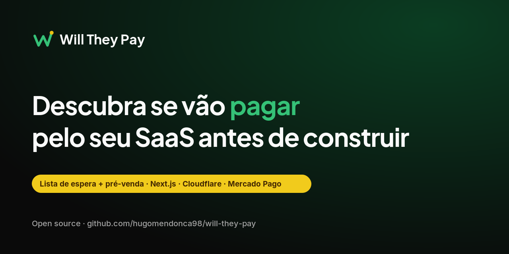

**[Ler em inglês (README.md)](README.md)** · [](LICENSE)

**Descubra se vão pagar pelo seu SaaS antes de construir.**

O Will They Pay é um template open source de lista de espera e pré-venda. Publique a página da sua ideia, junte interessados e aceite reservas pagas em Pix, cartão ou boleto pelo Mercado Pago. Feito com Next.js 16 na Cloudflare Workers e D1.

Este repositório é público. **Nunca commite tokens, secrets, account ids ou database ids reais.**

## O que vem pronto

- Landing de marketing (textos em `src/content/site.ts`) com formulário de leads e planos de **demonstração** para testar o Checkout Pro.
- Captura de leads (nome, e-mail, telefone, mensagem) com validação Zod, server actions e persistência no D1.
- Fluxo Checkout Pro: cria pedido no D1, cria preferência no Mercado Pago, redireciona ao checkout e trata retornos `success` / `failure` / `pending`.
- `POST /api/webhooks/mercadopago` com validação de `x-signature` (HMAC-SHA256) e atualização de pedido/pagamento no D1.
- Camada de pagamentos tipada, Vitest + MSW (sem chamadas reais ao Mercado Pago nos testes).
- CI no GitHub Actions: lint, typecheck e testes.

A UI está em **português brasileiro**. Código, identificadores e comentários em **inglês**.

## Stack e pré-requisitos

| Peça | Versão / notas |
| --- | --- |
| **Runtime** | Node.js **22+** (`engines` no `package.json`) |
| **Gerenciador de pacotes** | **pnpm** (`packageManager` no `package.json`; ative com `corepack enable`) |
| **Framework** | Next.js **16.3.8** (App Router) |
| **Deploy** | Cloudflare Workers via [`@opennextjs/cloudflare`](https://github.com/opennextjs/cloudflare) |
| **Banco** | Cloudflare **D1** + **Drizzle ORM** |
| **Pagamentos** | Mercado Pago **Checkout Pro** (Pix, cartão, boleto) |
| **Estilo** | Tailwind CSS 4 + shadcn/ui |

**Contas necessárias:**

1. Conta [Cloudflare](https://dash.cloudflare.com/) com Workers habilitado.
2. Aplicação no [Mercado Pago Developers](https://www.mercadopago.com.br/developers/panel/app) (credenciais de **teste** para local/sandbox).
3. **Wrangler CLI** (dev dependency). Faça login antes de D1 remoto ou deploy:

   ```bash
   pnpm wrangler login
   ```

## Scripts

| Comando | Função |
| --- | --- |
| `pnpm dev` | `next dev` — Next.js local com bindings Cloudflare via integração dev do OpenNext |
| `pnpm build` | `next build` |
| `pnpm preview` | `opennextjs-cloudflare build` + `opennextjs-cloudflare preview` (runtime Workers local) |
| `pnpm deploy` | `opennextjs-cloudflare build` + `opennextjs-cloudflare deploy` |
| `pnpm test` | Vitest (uma execução) |
| `pnpm test:watch` | Vitest em modo watch |
| `pnpm typecheck` | `tsc --noEmit` |
| `pnpm lint` | ESLint |
| `pnpm format` | Prettier (escrever) |
| `pnpm format:check` | Prettier (verificar) |
| `pnpm db:generate` | `drizzle-kit generate` → SQL em `./drizzle` |
| `pnpm db:migrate` | Aplica migrations no D1 **local** (alias de `db:migrate:local`) |
| `pnpm db:migrate:local` | `wrangler d1 migrations apply DB --local` |
| `pnpm db:migrate:remote` | `wrangler d1 migrations apply DB --remote` |
| `pnpm cf-typegen` | Regenera `cloudflare-env.d.ts` a partir dos bindings do Wrangler |

## Rodar localmente (passo a passo)

### 1. Clonar e instalar

```bash
git clone https://github.com/hugomendonca98/will-they-pay.git
cd will-they-pay
corepack enable
pnpm install
```

### 2. Arquivo de ambiente local

```bash
cp .dev.vars.example .dev.vars
```

Edite `.dev.vars` com credenciais de **teste** do Mercado Pago (veja [Configurar](#configurar-o-projeto)). `.dev.vars` está no `.gitignore`.

Opcional: copie `.env.example` para `.env.local` se alguma ferramenta Next precisar; **secrets e vars do Worker ficam em `.dev.vars`**, não no git.

### 3. Aplicar migrations do D1 (local)

```bash
pnpm db:migrate
```

O `database_id` placeholder em `wrangler.jsonc` é esperado para D1 **local**. As tabelas são criadas no D1 local do Wrangler.

### 4. Subir o servidor de desenvolvimento

```bash
pnpm dev
```

Abra [http://localhost:3000](http://localhost:3000). Em desenvolvimento, `next.config.ts` chama `initOpenNextCloudflareForDev()` para expor D1 e vars de `.dev.vars` ao código servidor.

### 5. Preview no runtime Workers (opcional)

```bash
pnpm preview
```

Gera o build OpenNext e roda o dev server do Wrangler. Veja no terminal a URL (com frequência `http://localhost:8787`). Se faltarem tabelas, rode `pnpm db:migrate:local` de novo.

Ajuste `APP_URL` em `.dev.vars` para a URL que você usa nos links de retorno do checkout (sem barra no final).

### 6. Verificações de qualidade

```bash
pnpm lint
pnpm typecheck
pnpm test
```

O CI executa os mesmos três comandos; os testes usam SQLite em memória e MSW — **não** leem `.dev.vars` nem chamam o Mercado Pago.

## Configurar o projeto

### Variáveis e secrets

| Nome | Tipo | Local | Produção |
| --- | --- | --- | --- |
| `NEXTJS_ENV` | var | `.dev.vars` — use `development` para `pnpm dev` | Não obrigatório no deploy |
| `APP_URL` | var pública | `.dev.vars` — ex.: `http://localhost:3000` | `vars` em `wrangler.jsonc` (HTTPS, sem barra final) |
| `MERCADOPAGO_SANDBOX` | var pública | `.dev.vars` — `true` no sandbox | `vars` em `wrangler.jsonc` — `true` ou `false` |
| `DEMO_MODE` | var pública (opcional) | `.dev.vars` — omita ou `false` (padrão desligado) | `vars` em `wrangler.jsonc` ou painel Cloudflare — `"true"` só no deploy de demo público |
| `MERCADOPAGO_ACCESS_TOKEN` | **secret** | `.dev.vars` | `pnpm wrangler secret put MERCADOPAGO_ACCESS_TOKEN` |
| `MERCADOPAGO_WEBHOOK_SECRET` | **secret** | `.dev.vars` | `pnpm wrangler secret put MERCADOPAGO_WEBHOOK_SECRET` |

**Onde obter valores no Mercado Pago**

1. Abra [Suas integrações](https://www.mercadopago.com.br/developers/panel/app) e crie ou selecione uma aplicação.
2. **Credenciais** → copie o Access Token de **teste** (`TEST-…`) para `MERCADOPAGO_ACCESS_TOKEN` em local/sandbox. Use o token de **produção** só como secret do Worker quando for ao ar.
3. **Webhooks** → configure notificações (abaixo) → revele o **secret** e defina `MERCADOPAGO_WEBHOOK_SECRET`.

Valores placeholder (ex.: `replace-with-your-test-access-token`) são tratados como ausentes para o checkout falhar fechado (`src/lib/env.ts`).

`APP_URL` define `back_urls` do Checkout Pro e o `notification_url` ao criar a preferência (`{APP_URL}/api/webhooks/mercadopago`). `auto_return` só é enviado quando `APP_URL` começa com `https://` (`src/lib/payments/service.ts`).

### Faixa de demo pública (opcional)

`DEMO_MODE` é lido em **runtime** no ambiente do Worker (`getCloudflareContext`), não no build — o mesmo artefato de deploy pode ser ligado/desligado sem rebuild.

- **Padrão:** desligado (omitir `DEMO_MODE` ou usar `false`). O `wrangler.jsonc` do template não habilita, então quem clona não herda a faixa.
- **Local / preview:** `DEMO_MODE=true` em `.dev.vars` (comentado em `.dev.vars.example`).
- **Cloudflare:** `DEMO_MODE` como `"true"` em `vars` no `wrangler.jsonc` só do Worker de demo/staging, ou no [painel Cloudflare](https://dash.cloudflare.com/) → **Workers & Pages** → seu worker → **Settings** → **Variables**. Textos em `site.demoBanner` (`src/content/site.ts`).

### Banco D1

`wrangler.jsonc` vem com `database_id` **placeholder** (`00000000-0000-0000-0000-000000000000`). O D1 local funciona assim. Em **produção**:

```bash
pnpm wrangler d1 create will-they-pay
```

Copie o `database_id` impresso para `wrangler.jsonc` em `d1_databases` (evite commitar ids reais se o repo for template compartilhado).

Após mudanças no schema:

```bash
pnpm db:generate       # opcional: gerar SQL a partir do schema Drizzle
pnpm db:migrate:local  # local
pnpm db:migrate:remote # remoto (exige wrangler login ou CLOUDFLARE_API_TOKEN)
```

### Webhook do Mercado Pago (manual — não é automático)

`pnpm deploy` **não** cadastra nem configura webhooks no painel do Mercado Pago. Você precisa fazer isso:

1. Faça deploy (ou use um túnel) até `https://SEU_DOMINIO/api/webhooks/mercadopago` estar acessível.
2. No Mercado Pago → **Webhooks** → configurar notificações:
   - **URL:** `https://SEU_DOMINIO/api/webhooks/mercadopago`
   - **Evento:** Pagamentos (e outros que precisar)
3. Salve e copie o **secret** do webhook para `MERCADOPAGO_WEBHOOK_SECRET`.

Para testar webhook **localmente**, o Mercado Pago exige URL HTTPS pública — use um túnel (Cloudflare Tunnel, ngrok, etc.) e aponte o painel para o túnel. Defina `APP_URL` com essa origem pública.

O handler valida `x-signature` (`ts=…,v1=…`), monta o manifesto `id:{data.id};request-id:{x-request-id};ts:{ts};` e compara HMAC-SHA256 em tempo constante antes de buscar o pagamento e atualizar o D1.

### Testar pagamento no sandbox

1. Mantenha `MERCADOPAGO_SANDBOX=true` e access token de **teste** em `.dev.vars`.
2. Rode `pnpm dev` (ou `pnpm preview` com `APP_URL` coerente).
3. Na home, use **Testar uma reserva** (rola até os planos demo) ou abra `/#precos`, escolha um plano e conclua o Checkout Pro.
4. Use [usuários de teste](https://www.mercadopago.com.br/developers/pt/docs/your-integrations/test/accounts) e [cartões de teste](https://www.mercadopago.com.br/developers/pt/docs/checkout-pro/additional-content/test-cards) conforme a documentação do Mercado Pago.

Preços dos planos demo estão em `src/content/site.ts` (`site.pricing.plans`); são só ilustração.

## Deploy na Cloudflare (passo a passo)

1. `pnpm wrangler login`
2. Crie o banco D1 e configure `database_id` em `wrangler.jsonc` (veja [D1](#banco-d1)).
3. Defina vars públicas em `wrangler.jsonc`, no mínimo:
   - `APP_URL` — URL HTTPS do Worker (domínio próprio ou `*.workers.dev`)
   - `MERCADOPAGO_SANDBOX` — `true` até migrar para credenciais live
4. Defina secrets (interativo; evite colar secrets em shell compartilhado):

   ```bash
   pnpm wrangler secret put MERCADOPAGO_ACCESS_TOKEN
   pnpm wrangler secret put MERCADOPAGO_WEBHOOK_SECRET
   ```

5. Aplique migrations no D1 de produção:

   ```bash
   pnpm db:migrate:remote
   ```

6. Deploy:

   ```bash
   pnpm deploy
   ```

7. No painel do Mercado Pago, configure a URL de webhook do domínio **publicado** (veja [Webhook](#webhook-do-mercado-pago-manual--não-é-automático)).
8. Ao ir para produção, use credenciais live, `MERCADOPAGO_SANDBOX=false` e faça deploy de novo.

Em CI de deploy, guarde `CLOUDFLARE_API_TOKEN`, account id e ids do D1 em **secrets do GitHub Actions** — nunca neste repositório.

## Personalizar marca e conteúdo

| O quê | Onde |
| --- | --- |
| Nome, URLs, textos de marketing, planos demo | `src/content/site.ts` |
| Tokens de cor e tipografia | `src/app/globals.css` |
| Logos e favicons | `public/brand/` (caminhos em `site.brand`) |
| Ilustração do hero (terminal + fluxo de validação) | `src/components/marketing/hero-visual.tsx` — troque por screenshot do produto se quiser |

## Estrutura do projeto

```
src/content/          Copy de marketing e planos demo (site.ts)
src/app/              Páginas App Router, actions, rota de webhook
src/components/       UI (shadcn), marketing, formulários
src/lib/db/           Schema Drizzle e client D1
src/lib/leads/        Validação e persistência de leads
src/lib/payments/     Cliente MP, webhook, serviço de checkout
drizzle/              Migrations SQL versionadas
public/brand/         Assets de marca
docs/                 Banners do README e outros assets de docs
```

**Rotas de UI:** `/` (landing), `/checkout/success`, `/checkout/failure`, `/checkout/pending`.

**API:** `POST /api/webhooks/mercadopago`.

## Integração contínua (CI)

Workflow: `.github/workflows/ci.yml` — em push na `main` e em pull requests:

- `pnpm lint`
- `pnpm typecheck`
- `pnpm test`

O CI não precisa de credenciais Mercado Pago ou Cloudflare.

## Solução de problemas

**Next.js fixado em 16.3.8** — Versões 16.4.x podem quebrar `@opennextjs/cloudflare@1.20.9` (ex.: `preview-props.json`; veja [opennextjs/cloudflare#1355](https://github.com/opennextjs/cloudflare/issues/1355)). Há patch `pnpm` em `patches/`; revise ao atualizar.

**Cache Components** — Desligado: habilitar com esta versão do OpenNext pode travar o Worker local. Veja comentários em `next.config.ts`.

**Checkout falha na hora** — Confira tokens de teste reais em `.dev.vars` (não placeholders) e se rodou `pnpm db:migrate`.

**Webhook não atualiza pedidos** — Confirme URL e secret no painel do Mercado Pago, endpoint HTTPS e acessível publicamente.

## Contribuir

Issues e pull requests são bem-vindos no [GitHub](https://github.com/hugomendonca98/will-they-pay). Não inclua secrets; rode `pnpm lint`, `pnpm typecheck` e `pnpm test` antes de abrir PR.

## Licença

Este projeto está sob a [licença MIT](LICENSE).
